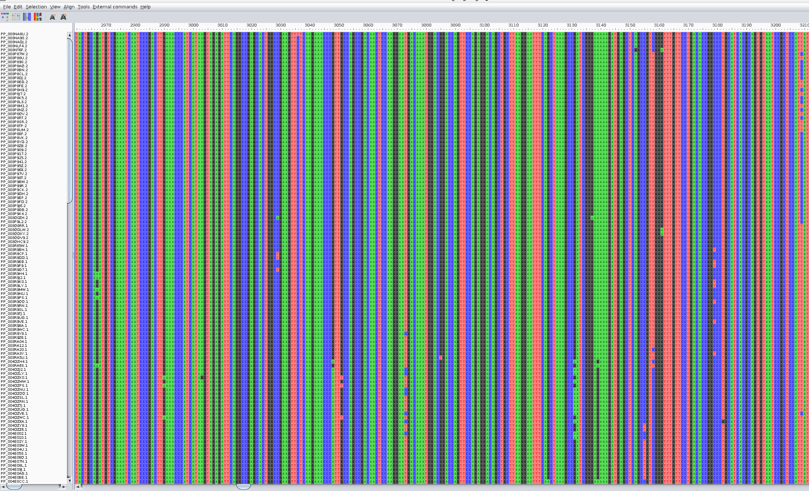

# Bioinformatics_shortcourse_MSA
A tutorial detailing the process of multiple sequence alignment using MAFFT, and curation of the resulting alignment using AliView


## Learning Objectives 
By the end of this tutorial, you will learn:
- What multiple sequence alignment (MSA) is
- How to perform MSA using MAFFT
- How to visualize and curate the resulting alignment

## What is Multiple Sequence Alignment?
Multiple sequence alignment involves arranging/aligning multiple related sequences to detect homologous regions. The conserved regions reveal evolutionary relationships, forming the basis for building phylogenetic trees.

## Performing MSA using MAFFT
MAFFT is a widely utilised software for multiple sequence alignment, providing a balance between speed and accuracy. 
Details on usage are available in the official documentation.

To install MAFFT, we run the following command: 
```
conda install -c bioconda mafft
```
Check the version:
```
mafft --version
```

A folder is required for the MAFFT output, which can be created by running the following code:

```
mkdir -p results/mafft
```
Run the command to generate the alignment:

```
mafft --auto sequences.fasta > aligned.fasta
```
With --auto, MAFFT chooses the best algorithm for aligning the sequences. 


## Visualizing and Curating the Alignment Using AliView
AliView is a lightweight and fast software that is useful in visualizing the resulting alignment. Sometimes, an MSA may result in poorly aligned sequence ends or incorrect gaps, leading to an incorrect phylogenetic tree. 
AliView enables the identification of these regions and enables the removal of low-quality regions, e.g., highly gapped regions and poor sequence ends.  

To install AliView, we run the command:
```
conda install -c bioconda aliview
```
In AliView, click  File → Open, then upload the sequence alignment to visualize. 


